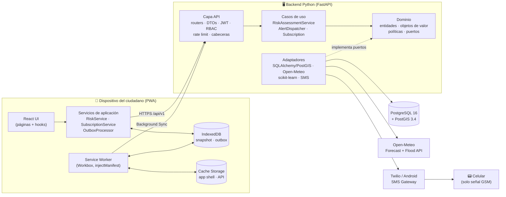
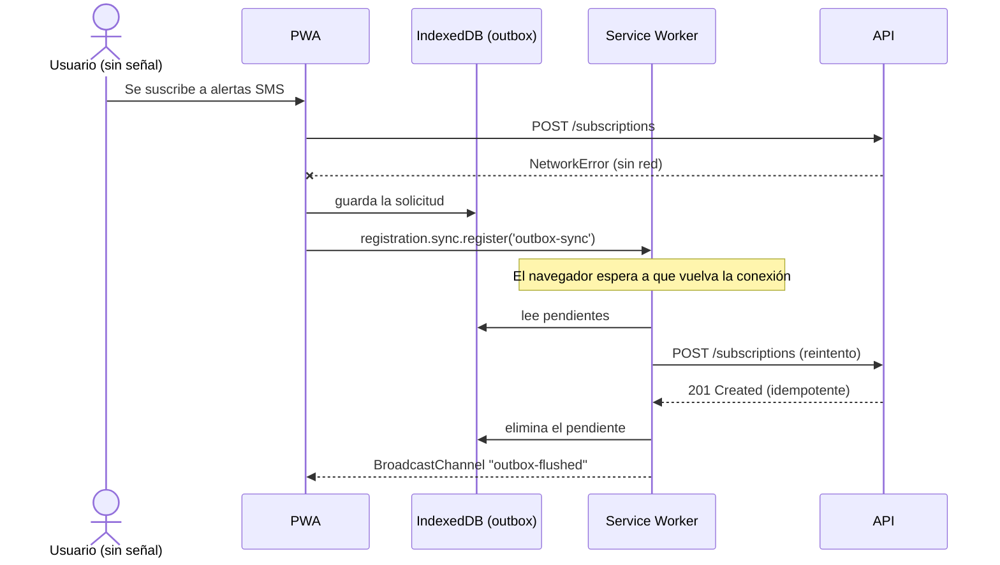
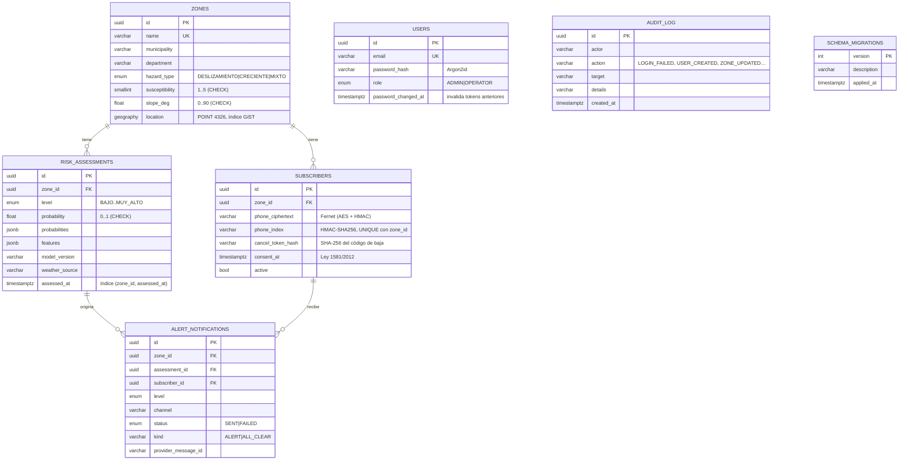
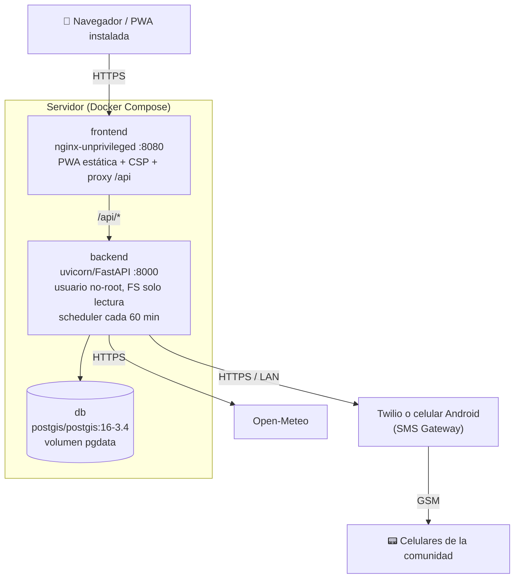

# AlertaSinRed — Documento de arquitectura (avance)

**Curso:** Programación Orientada a la Web · Ingeniería de Software, 7.º semestre · UCC Pasto
**Estado:** avance funcional de extremo a extremo (IA + offline-first + SMS)

---

## 1. Problema y propuesta de valor

Las comunidades en zonas de riesgo de Nariño y Putumayo (laderas de Pasto, zona de
influencia del Galeras, Mocoa, ríos Telembí y Mira) suelen tener conexión intermitente.
Justo cuando más necesitan una alerta, es cuando menos probable es que tengan internet.

AlertaSinRed combina:

1. **IA de riesgo** — un clasificador (Random Forest) estima el nivel de riesgo
   (bajo / moderado / alto / muy alto) a partir de lluvia, humedad del suelo, caudal
   de ríos, pendiente y susceptibilidad del terreno.
2. **Arquitectura web offline-first** — la PWA guarda el último estado de riesgo en el
   dispositivo (Service Worker + IndexedDB) y sigue funcionando sin red.
3. **SMS de respaldo** — si el riesgo es alto, el servidor envía un SMS, que no necesita
   datos móviles.

**Estado del arte:** la app *Ideam en tu Mano* (IDEAM, jun. 2026) ofrece alertas en tiempo
real, pero requiere conexión. AlertaSinRed se diferencia por ser offline-first y por el
SMS de respaldo.

---

## 2. Arquitectura general (diagrama de componentes)



### 2.1 Backend: arquitectura hexagonal (puertos y adaptadores)

```
backend/app/
├── domain/            ← Núcleo: NO depende de FastAPI, SQL ni scikit-learn
│   ├── entities.py        Zone, RiskAssessment, Subscriber, AlertNotification, User
│   ├── value_objects.py   RiskLevel, Coordinates, PhoneNumber, RiskFeatures, WeatherConditions
│   ├── policies.py        AlertPolicy (enfriamiento/escalamiento), AlertMessageBuilder (GSM-7)
│   ├── events.py          RiskAssessed
│   ├── ports.py           Interfaces: repositorios, UnitOfWork, WeatherProvider, SmsGateway, RiskModel…
│   └── exceptions.py      Jerarquía de errores de negocio
├── application/       ← Casos de uso (orquestan el dominio a través de puertos)
│   ├── event_bus.py       Publicador/suscriptor en proceso
│   └── services/          risk_assessment · alert_dispatcher · subscriptions · zones · auth
├── infrastructure/    ← Adaptadores concretos
│   ├── db/                ORM SQLAlchemy 2 + GeoAlchemy2, repositorios, Unit of Work
│   ├── memory/            Repositorios en memoria (pruebas y demo sin BD)
│   ├── weather/           OpenMeteoWeatherProvider, FakeWeatherProvider
│   ├── sms/               Console / Twilio / AndroidSmsGateway + Factory
│   └── ml/                SklearnRiskModel (carga con verificación SHA-256)
├── api/               ← Adaptador de entrada HTTP (FastAPI)
├── core/              ← Configuración, seguridad, logging
└── container.py       ← Raíz de composición (inyección de dependencias)
```

**Regla de dependencias:** las flechas apuntan siempre hacia el dominio. Cambiar
PostgreSQL por otra base de datos, u Open-Meteo por el IDEAM, solo requiere escribir
un adaptador nuevo que implemente el mismo puerto.

### 2.2 Frontend: capas equivalentes

```
frontend/src/
├── domain/           tipos, niveles de riesgo, geodesia (Haversine), tiempo relativo
├── infrastructure/   ApiClient (HTTP tipado), IndexedDB (SnapshotRepository, OutboxRepository)
├── application/      RiskService, SubscriptionService, OutboxProcessor, AdminService
├── hooks/            estado de React (snapshot, conexión, outbox, sesión)
├── components/ pages/  interfaz
├── services.ts       raíz de composición del frontend
└── sw.ts             Service Worker (reutiliza las mismas clases de application/infrastructure)
```

---

## 3. Programación orientada a objetos y patrones de diseño

| Patrón / principio | Dónde | Para qué |
|---|---|---|
| **Arquitectura hexagonal** | `domain/ports.py` + `infrastructure/` | Aislar el negocio de la tecnología |
| **Repository** | `ZoneRepository`, `SqlZoneRepository`, `InMemoryZoneRepository` | Persistencia intercambiable |
| **Unit of Work** | `SqlAlchemyUnitOfWork` | Transacción única por caso de uso |
| **Adapter** | `OpenMeteoWeatherProvider`, `SklearnRiskModel` | Traducir APIs externas a objetos del dominio |
| **Strategy** | `SmsGateway` (Console, Twilio, Android) · `WeatherProvider` (real/simulado) | Cambiar comportamiento por configuración |
| **Factory** | `SmsGatewayFactory`, `create_app()` | Centralizar la creación de objetos |
| **Observer / Pub-Sub** | `EventBus` + `RiskAssessed` → `AlertDispatcher` | La evaluación no sabe que existen los SMS (abierto/cerrado) |
| **Dependency Injection / Composition Root** | `container.py`, `services.ts` | Un solo lugar conoce las clases concretas |
| **Value Object** | `PhoneNumber`, `Coordinates`, `RiskFeatures` | Inmutables y auto-validados |
| **Outbox** | `OutboxRepository` + `OutboxProcessor` (PWA) | No perder acciones hechas sin red |
| **DTO** | `api/schemas.py` | Separar el contrato HTTP del modelo de dominio |
| **Decorator** | `CachedWeatherProvider` envuelve cualquier `WeatherProvider` | Agregar caché sin modificar el proveedor ni los casos de uso |
| **Exclusión mutua (Lock)** | `JobLock`: `InProcessJobLock`, `PostgresAdvisoryJobLock` | Que la evaluación completa no corra dos veces a la vez, incluso con varias instancias |
| **Middleware / Chain of Responsibility** | `RequestContextMiddleware`, `BodySizeLimitMiddleware`, `SecurityHeadersMiddleware` | Preocupaciones transversales (trazabilidad, límites, cabeceras) fuera de los casos de uso |

**Encapsulamiento:** las reglas viven en la entidad que las conoce: `Subscriber.subscribe()`
exige consentimiento; `Zone.build_features()` neutraliza el caudal de ríos en zonas de
solo deslizamiento; `RiskLevel.requires_sms` decide qué niveles alertan;
`PhoneNumber.__str__` nunca imprime el número completo; `Subscriber.issue_cancel_token()`
guarda solo la huella del código de baja; `User.accepts_token_issued_at()` invalida las
sesiones anteriores a un cambio de contraseña; `AlertPolicy` decide entre alerta, fin de
alerta o silencio.

**Polimorfismo:** `AlertDispatcher` llama a `sms.send()` sin saber si detrás hay Twilio,
un celular Android o la consola.

**SOLID:** responsabilidad única (un servicio por caso de uso), abierto/cerrado (nuevos
suscriptores de eventos sin tocar la evaluación), sustitución de Liskov (los repositorios
en memoria y en PostGIS son intercambiables y pasan las mismas pruebas), segregación de
interfaces (puertos pequeños) e inversión de dependencias (el dominio define los puertos).

---

## 4. Estrategia offline-first (el reto técnico principal)

### 4.1 Qué se cachea y cuándo

| Recurso | Dónde | Estrategia | Cuándo se actualiza |
|---|---|---|---|
| App shell (HTML/JS/CSS/íconos) | Cache Storage | *Precache* | Al instalar una versión nueva del SW |
| Rutas de la SPA (`/zona/:id`) | Cache Storage | `index.html` precacheado | Idem |
| Estado de riesgo (`/risk/snapshot`) | IndexedDB + Cache Storage | *Network-first* (timeout 4 s) con respaldo local | Al abrir la app, al volver la red, cada hora con Periodic Sync |
| Historial de una zona | Cache Storage | *Stale-while-revalidate* | Cada vez que se consulta |
| Suscripciones hechas sin red | IndexedDB (`outbox`) | *Outbox* + Background Sync | En cuanto vuelve la conexión |
| `/auth/*`, `/admin/*` | — | **Nunca** se cachean | — |

### 4.2 ¿Por qué un *snapshot* único?

Un solo endpoint (`GET /risk/snapshot`) devuelve todas las zonas con su última
evaluación. Con **una** descarga exitosa, el dispositivo tiene todo lo necesario para
operar offline: listar zonas, ver detalle, recomendaciones e incluso calcular
"zonas cerca de mí" localmente (Haversine) cuando PostGIS no está alcanzable.

### 4.3 Sincronización de la bandeja de salida



- **Idempotencia:** el backend responde igual si la suscripción ya existía, así que
  reenviar no crea duplicados.
- **Errores permanentes vs. transitorios:** un 4xx (dato inválido) se descarta y se
  informa; un 5xx o falta de red se reintenta (máx. 8 intentos).
- **Navegadores sin Background Sync** (Firefox, Safari): la página vacía la bandeja al
  recibir el evento `online`.

---

## 5. Componente de IA

### 5.1 Variables del modelo

| Variable | Fuente | Tipo |
|---|---|---|
| Lluvia 24 h, 72 h y 7 días (mm) | Open-Meteo Forecast API (horaria, `past_days=7`) | Dinámica |
| Lluvia pronosticada 24 h (mm) | Open-Meteo Forecast API | Dinámica |
| Humedad del suelo 3–9 cm (m³/m³) | Open-Meteo Forecast API | Dinámica |
| Caudal pronosticado / caudal medio 30 días | Open-Meteo Flood API (GloFAS) | Dinámica |
| Pendiente del terreno (°) | DEM SRTM (provisional) | Estática |
| Susceptibilidad a movimientos en masa (1–5) | SGC, zonificación 1:100.000 (provisional) | Estática |

### 5.2 Modelo y métricas actuales

- **Algoritmo:** `RandomForestClassifier` (250 árboles, `class_weight="balanced"`).
- **Métricas (conjunto de prueba, 4 000 muestras):** F1-macro **0,84** · exactitud 0,84 ·
  recall ALTO 0,80 · recall MUY ALTO **0,92**. Validación cruzada 5-fold: 0,837 ± 0,006.
- **Ningún caso de riesgo alto/muy alto fue clasificado como bajo** (ver matriz de
  confusión en `backend/models/risk_model.meta.json`).
- **Explicabilidad:** cada evaluación devuelve "factores clave" legibles
  (p. ej. *"Lluvia acumulada muy alta en 72 h (147 mm)"*) y la probabilidad por nivel.

### 5.3 Honestidad metodológica: fases de los datos

- **Fase 1 (este avance):** datos sintéticos generados con una función de riesgo basada
  en la literatura (lluvia antecedente + detonante, saturación, susceptibilidad,
  pendiente, caudal) más ruido de etiquetado. Permite construir y validar todo el
  pipeline.
- **Fase 2 (siguiente entrega):** reentrenar con eventos reales cruzando el inventario
  **SIMMA** del SGC y **DesInventar** con la serie histórica de Open-Meteo (Archive API)
  en la fecha y lugar de cada evento. `python -m ml.train --data eventos.csv` ya lo
  soporta sin cambiar código.
- **Hallazgo de la prueba con datos reales:** en la costa pacífica (Tumaco, Barbacoas)
  lloviznas "normales" superan los 130 mm en 72 h, así que se requiere **calibrar por
  climatología local** (usar anomalías respecto al promedio histórico del punto en vez de
  valores absolutos). Queda en la hoja de ruta.

---

## 6. Modelo de datos (PostgreSQL + PostGIS)



Consultas espaciales destacadas:

- `ST_DWithin(location, punto, radio)` + `ST_Distance` para "zonas cerca de mí"
  (usa el índice GiST).
- `DISTINCT ON (zone_id) … ORDER BY zone_id, assessed_at DESC` para obtener la última
  evaluación por zona en una sola consulta.

---

## 7. Seguridad (OWASP Top 10 aplicado)

| Riesgo | Control implementado |
|---|---|
| **A01 Control de acceso** | JWT + RBAC (`require_role`) con el rol vigente en la base en cada petición; una cuenta desactivada pierde el acceso de inmediato; `/admin` nunca se cachea en el SW; la baja de una suscripción exige el código que solo tiene el dispositivo |
| **A02 Fallas criptográficas** | Contraseñas con **Argon2id**; teléfonos **cifrados en reposo** (Fernet) + índice ciego HMAC-SHA256; secretos solo por variables de entorno; HSTS en producción |
| **A03 Inyección** | Consultas parametrizadas del ORM (sin SQL concatenado); DTOs con `extra="forbid"`, longitudes y patrones; CSP estricta en el frontend (sin scripts inline) |
| **A04 Diseño inseguro** | Suscripción idempotente; una suscripción activa no emite códigos de baja nuevos; enfriamiento de alertas contra "fatiga"; consentimiento obligatorio; siempre queda un administrador activo; SMS de prueba limitado a 5 por hora |
| **A05 Configuración** | La app no arranca con secretos débiles o CORS `*` en producción; `/docs` deshabilitado en producción; contenedores sin root, sistema de archivos de solo lectura, `no-new-privileges`; cuerpos de petición limitados a 64 KB (413); tiempos límite de conexión a la base |
| **A07 Autenticación** | Rate limiting en login por IP (5/min) **y por cuenta** (10 cada 15 min, no se evade falseando la IP); mensaje genérico de error; hash señuelo contra enumeración por tiempo; JWT con `exp`, `iss` y lista fija de algoritmos (bloquea `alg=none`); cambio de contraseña que cierra las demás sesiones; hashes Argon2 actualizados al iniciar sesión si sus parámetros quedaron antiguos |
| **A08 Integridad de software/datos** | El modelo de IA solo se carga si su **SHA-256** coincide con los metadatos (pickle puede ejecutar código) y si el orden de variables es el esperado |
| **A09 Registro y monitoreo** | **Bitácora de auditoría** (inicios de sesión exitosos y fallidos, cuentas, zonas, evaluaciones, SMS de prueba); identificador `X-Request-ID` en cada petición y en cada línea de log; el cliente nunca recibe trazas; teléfonos siempre enmascarados; el log de acceso omite la consulta (puede llevar la ubicación) |
| **A10 SSRF** | URLs de servicios externos fijas por configuración; el usuario nunca controla a qué host se conecta el servidor |
| **Privacidad** | Token de operador solo en memoria (no `localStorage`); la ubicación del usuario no se almacena; el CSV exportado neutraliza fórmulas (inyección de CSV) |

---

## 8. Diagrama de despliegue



El frontend y la API comparten origen (Nginx hace de proxy), lo que elimina CORS en
producción y permite que el Service Worker intercepte las peticiones a la API.

---

## 9. Calidad y pruebas

- **Backend:** 138 pruebas (pytest).
  - 132 unitarias y de API (repositorios en memoria): dominio, políticas de alerta y fin de
    alerta, casos de uso, seguridad (JWT alterado, `alg=none`, token expirado, sesiones
    cerradas al cambiar la clave, cifrado, rate limiting por IP y por cuenta, límite de
    tamaño), integridad del modelo, caché y reintentos del clima, candado de evaluación,
    bitácora y exportación CSV.
  - 6 de integración contra PostgreSQL + PostGIS reales (`tests/integration`, requieren
    `TEST_DATABASE_URL`): consulta espacial, `DISTINCT ON`, cifrado en reposo,
    migraciones y flujo completo de alertas.
  - Linter `ruff` con reglas de seguridad (Bandit). GitHub Actions ejecuta todo en cada
    push, con un servicio PostGIS, y construye la imagen Docker.
- **Frontend:** 11 pruebas (Vitest) de la lógica offline con IndexedDB simulado y una red
  que se puede "cortar": caché, outbox, reintentos y errores permanentes. TypeScript en
  modo estricto.

---

## 10. Hoja de ruta

1. Reentrenar el modelo con eventos reales (SIMMA/DesInventar + Open-Meteo Archive).
2. Calibración por climatología local (anomalías de lluvia) para la región pacífica.
3. Cargar la capa oficial de susceptibilidad del SGC (shapefile → polígonos PostGIS) y
   calcular la susceptibilidad por intersección espacial (`ST_Intersects`).
4. Verificación del número por OTP antes de activar la suscripción, y baja respondiendo
   "BAJA" por SMS (hoy la baja se hace desde el dispositivo con su código).
5. Notificaciones push (Web Push) desde el servidor como canal adicional del `EventBus`.
6. Rate limiting distribuido en Redis cuando haya más de una instancia de la API.
7. Fuente oficial IDEAM (datos.gov.co / Socrata) como `WeatherProvider` alternativo.

**Ya implementado desde el avance:** gestión de operadores y de zonas, baja de
suscripciones, SMS de fin de alerta, bitácora de auditoría, cambio de contraseña,
migraciones versionadas, caché y reintentos del clima, ficha pública del modelo, CI y
pruebas de integración.
